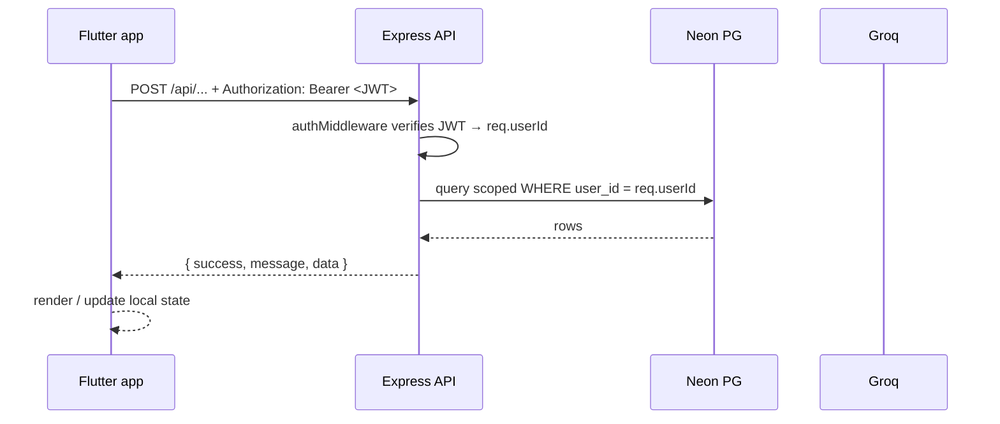
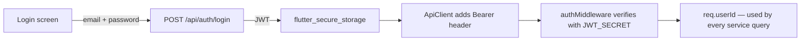
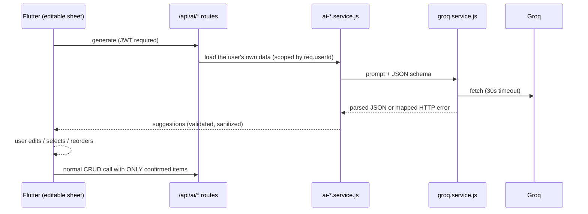
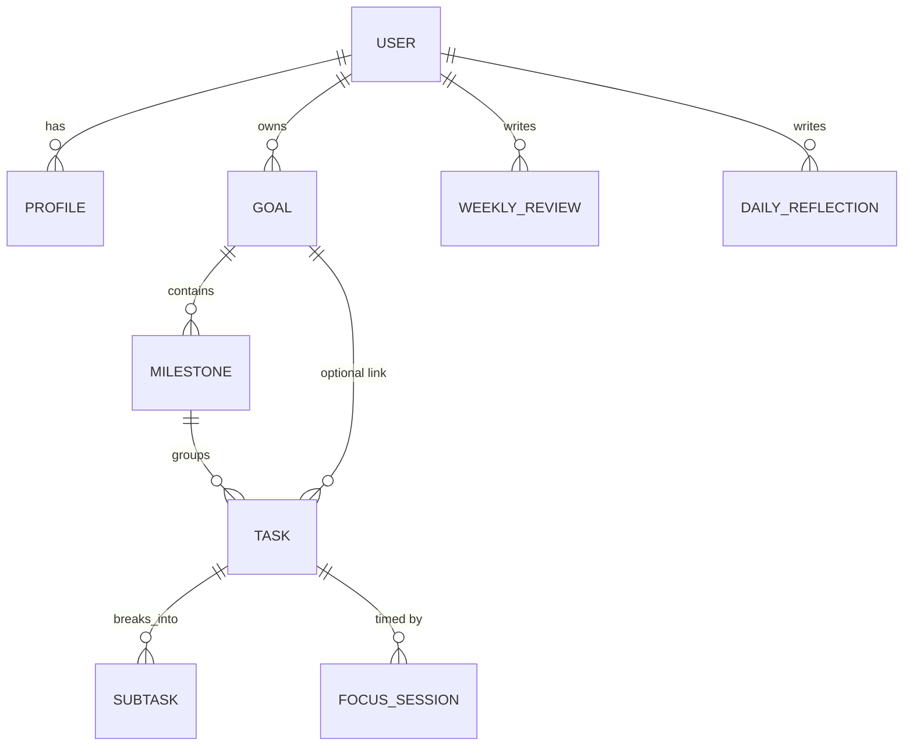

# GRIVIO — Architecture

How the three components fit together and how data flows through the system.

## Components

| Component | Responsibility | Must never |
| --- | --- | --- |
| **Flutter app** (`mobile/`) | UI, local state, secure token storage, preview/confirm flows | hold backend secrets, talk to Groq directly, decide ownership |
| **Express API** (`backend/`) | auth, validation, business logic, SQL, Groq proxy | trust anything the client says about *who* is asking (token decides) or *what* is valid (server validates) |
| **Neon PostgreSQL** | persistent storage (9 tables, migrations 001–006) | be reachable from the app directly |

## Request lifecycle

Every layer has one job: routes pick the controller, controllers validate and
delegate, services own the SQL, and `config/db.js` owns the connection pool.

## Authentication flow

- JWTs are stateless: logout simply discards the token on the client.
- Expired/invalid tokens → 401 "Invalid or expired token"; logging in again
  fixes it.
- Ownership is enforced in SQL, so even a hand-crafted request with a valid
  token of user A can never touch user B's rows.

## AI flow (preview-first)

Key invariants:

1. The backend **never** writes AI output to the database.
2. Prompts contain only the requesting user's own data.
3. Client free-text is *input to consider*, never instructions to obey.
4. Guardrails (low-data skip, statistic scrubber, foreign-ID dropping) keep
   suggestions honest — see [`AI_FEATURES.md`](AI_FEATURES.md).

## Data model (simplified)

Tables are created by `backend/migrations/001..006*.sql` (tracked in
`schema_migrations`); weekly reviews and reflections have unique constraints
that power create-or-replace upserts, and weeks always start on **Monday**.

## Design system (Flutter)

`core/theme/app_theme.dart` defines paired light/dark tokens (~85–90 %
neutral surfaces, 10–15 % accent). `widgets/neumorphic.dart` turns those
tokens into tactile raised/inset surfaces; `widgets/ui_kit.dart` adds
ambient background glow and entrance animations. `ThemeController` persists
Light/Dark/System and rebuilds live.
